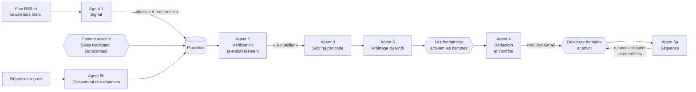

# Résonance : un système d'agents de prospection B2B pour le luxe

Système de prospection fondé sur les signaux d'affaires, conçu pour une maison créative parisienne au service des maisons de luxe et des marques premium. Sept agents automatisés dans **n8n** repèrent les signaux dans l'actualité, vérifient les faits, notent les comptes, rédigent des messages individualisés et suivent les réponses. **Pipedrive** sert de CRM de référence. Aucun email ne part sans relecture humaine.

> Projet réalisé pour la compétition finale du MBA Digital Marketing & Business de l'EFAP (septembre 2026), sur un brief réel de la maison Anna & Louise, au sein d'une équipe de cinq. J'ai conçu l'architecture des agents et construit les workflows n8n.

## Le problème

Une maison créative qui travaille pour le luxe ne peut pas prospecter comme un éditeur de logiciels. Ses interlocuteurs sont peu nombreux, très sollicités et attentifs aux codes : un message générique, une familiarité ou une erreur sur un fait suffit à fermer une porte durablement. Le brief demandait donc un système qui fasse gagner du temps **sans dégrader la qualité perçue** :

- repérer le bon moment (une nomination, un repositionnement, un lancement) plutôt qu'envoyer en masse ;
- ne jamais affirmer un fait non vérifié ni inventer une référence client ;
- écrire chaque message pour une personne précise, dans le ton de son univers ;
- laisser les fondatrices décider de qui est contacté, et quand.

## Ce que fait le système



Les losanges marquent les quatre points de validation humaine. Le détail de chaque agent est dans [docs/architecture.md](docs/architecture.md).

| Workflow | Déclenchement | Rôle |
|---|---|---|
| 0 · Installation | Une fois | Crée les 35 champs personnalisés dans Pipedrive et contrôle les 8 étapes du pipeline |
| 1 · Signal | Chaque jour à 6 h | Lit la veille, fait extraire le signal et un extrait cité mot pour mot, crée l'affaire |
| 2 · Identification et enrichissement | Toutes les 15 min | Vérifie le fait dans la page source, applique les exclusions, formule une hypothèse étiquetée |
| 3 · Scoring et priorisation | Toutes les 15 min | Calcule une note sur 100 avec une grille à 7 critères, sans modèle de langage |
| 4 · Rédaction | Toutes les 10 min | Rédige le premier message, le soumet à 9 contrôles, le dépose en brouillon Gmail |
| 5a · Séquence | Toutes les 15 min | Détecte l'envoi, crée la tâche LinkedIn à J+3, prépare les relances à J+5, J+12 et J+25 |
| 5b · Réponses | Toutes les 5 min | Classe chaque réponse en 7 catégories et applique le scénario correspondant |
| 6 · Synchronisation et arbitrage | Chaque lundi à 8 h | Envoie la liste des comptes à arbitrer et un export de secours en CSV |

## Les choix de conception

**Le modèle de langage ne décide de rien d'important.** Gemini extrait, reformule et rédige. Le score, les exclusions, l'espacement des envois, le choix de l'angle et le contrôle des messages sont calculés par du code, donc reproductibles et explicables. Chaque note de score détaille les points par critère.

**Un fait ne sert que s'il est vérifié.** L'agent 1 exige un extrait cité mot pour mot avec son URL et sa date. L'agent 2 télécharge la page et vérifie que l'extrait y figure, au mot près ou à 85 % des mots. Un fait qui échoue bloque la rédaction.

**Ce qui est supposé est écrit comme tel.** L'enjeu probable du décideur est stocké dans un champ « Hypothèse » qui commence toujours par « Hypothèse : ». Dans l'email, il devient une question ouverte, jamais une affirmation.

**Les preuves viennent d'une bibliothèque validée.** Le modèle ne peut citer que la phrase de preuve choisie dans la configuration. Une preuve marquée « À valider » bloque le brouillon.

**Une maison est traitée comme un compte, pas comme une liste de contacts.** Deux interlocuteurs d'une même maison reçoivent des angles différents, des messages sans phrase commune (similarité inférieure à 30 %) et des envois espacés d'au moins 5 jours ouvrés.

**L'humain garde la main aux quatre moments qui comptent :** l'identification du bon décideur, l'activation du compte le lundi, la relecture et l'envoi depuis Gmail, l'invitation LinkedIn. Le volume est plafonné à 35 premiers messages par semaine.

## Conformité

La prospection B2B par email repose ici sur l'intérêt légitime. Le système l'outille de la façon suivante :

- chaque premier message comporte une mention d'information et un moyen simple de s'opposer (répondre « désinscription ») ;
- une opposition est datée sur la fiche, bloque tout envoi futur et figure dans un export dédié chaque lundi ;
- la provenance des coordonnées et la fiabilité de l'email sont tracées sur chaque personne ;
- une date de fin de conservation est posée à 36 mois ;
- un email invalide n'entraîne jamais d'envoi à une autre personne de la maison.

Ces règles traduisent les recommandations de la CNIL sur la prospection B2B ; elles ne remplacent pas l'avis d'un juriste.

## Documentation

| Document | Contenu |
|---|---|
| [docs/architecture.md](docs/architecture.md) | Cycle de vie d'une affaire, fonctionnement détaillé de chaque agent |
| [docs/schema_pipedrive.md](docs/schema_pipedrive.md) | Les 8 étapes du pipeline, les 35 champs et l'agent qui écrit chacun |
| [docs/grille_scoring.md](docs/grille_scoring.md) | Les 7 critères, leurs barèmes et les seuils de niveau |
| [docs/redaction_et_controles.md](docs/redaction_et_controles.md) | Angles, tons, discrétion sur l'IA, contrôles automatiques, relances, réponses |
| [docs/installation.md](docs/installation.md) | Installation pas à pas : identifiants, configuration, ordre de mise en service |

## Outils

n8n · Pipedrive (API v1) · Gemini (Google AI Studio) · Gmail API · Google Alertes (flux RSS) · LinkedIn Sales Navigator et Dropcontact pour l'identification des contacts

## Structure du dépôt

```
luxury-b2b-prospecting-ai-agents/
├── README.md
├── docs/
│   ├── architecture.md
│   ├── schema_pipedrive.md
│   ├── grille_scoring.md
│   ├── redaction_et_controles.md
│   └── installation.md
└── workflows/
    ├── 00_installation_pipedrive.json
    ├── 01_agent_signal.json
    ├── 02_agent_identification_enrichissement.json
    ├── 03_agent_scoring_priorisation.json
    ├── 04_agent_redaction.json
    ├── 05a_agent_sequence.json
    ├── 05b_agent_reponses.json
    └── 06_agent_synchronisation_arbitrage_export.json
```

Les workflows sont publiés sans identifiants ni données de prospects. La bibliothèque de preuves contient des exemples à remplacer : tant qu'une phrase reste entre crochets, le contrôle automatique bloque le brouillon.

## Limites

- La vérification d'un fait échoue sur les pages payantes ou protégées ; l'affaire reste alors « À vérifier manuellement ».
- Les listes d'affaires sont lues par pages de 500 : au-delà, il faudrait ajouter la pagination de l'API Pipedrive.
- Le barème de score est un point de départ défini avec l'équipe ; il doit être recalé sur les premiers taux de réponse.
- Le classement des réponses peut se tromper : en cas de doute, l'affaire passe en « Conversation ouverte » et les fondatrices reçoivent une alerte.

---

**N. Danielle OUATTARA** · [LinkedIn](https://www.linkedin.com/in/ndanielleouattara/) · [Mes autres projets](https://github.com/niyadanielleO)
