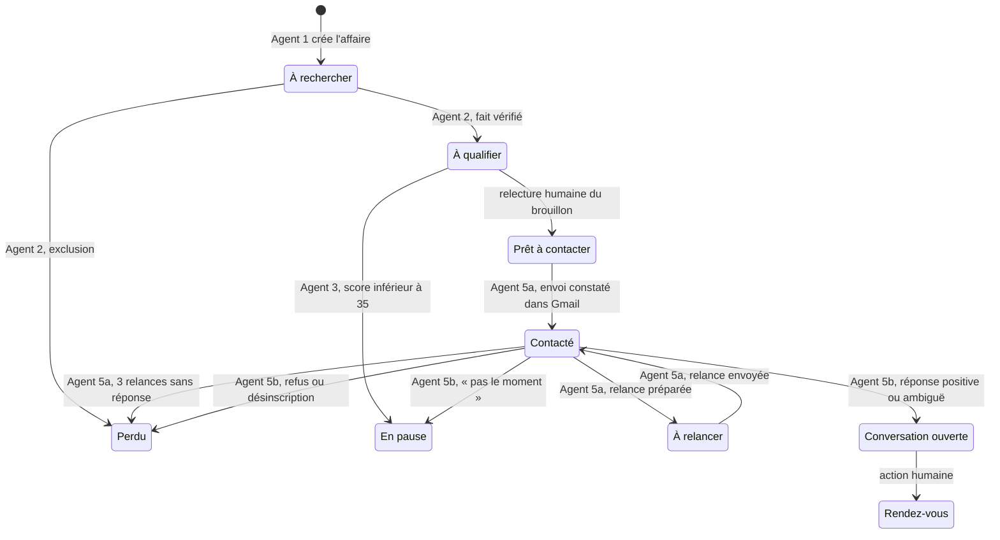

# Architecture

Résonance repose sur un principe simple : **Pipedrive est la seule source de vérité.** Chaque agent lit l'état d'une affaire avant d'agir et écrit son résultat après, dans des champs nommés et dans une note datée. Les agents ne se parlent pas directement : ils se passent le relais par les étapes du pipeline. On peut donc arrêter, corriger ou relancer n'importe quel agent sans casser les autres.

## Cycle de vie d'une affaire

## Structure commune des workflows

Chaque workflow commence par les mêmes nœuds :

1. **Deux déclencheurs** : une planification et un bouton « Lancer maintenant (test) ».
2. **CONFIG** : un nœud de code identique dans tous les workflows (pipeline, modèles Gemini, signataire, plafond hebdomadaire, flux de veille, bibliothèque de preuves).
3. **PROMPT** : les consignes données au modèle, séparées de la logique pour pouvoir les relire et les modifier sans toucher au reste.
4. **Carte Pipedrive** : lit les champs et les étapes et les retrouve par leur **nom exact**. Si un champ ou une étape manque, le workflow s'arrête avec la liste précise de ce qu'il faut créer. Un champ personnalisé est prioritaire sur un champ système du même nom.

Les appels à Gemini se font en température 0 avec une réponse imposée en JSON, sont espacés de 4 secondes et sont relancés jusqu'à 5 fois en cas d'échec. Quand la configuration liste plusieurs modèles, chaque appel en choisit un au hasard pour répartir la charge sur les quotas gratuits.

## Agent 1 · Signal

**Chaque jour à 6 h.** L'agent lit les flux RSS configurés (articles de moins de 48 heures) et les emails du libellé Gmail « veille » des deux derniers jours. Il écarte ce qu'il a déjà vu dans les 30 derniers jours, puis soumet chaque article à Gemini, qui doit renvoyer la maison, sa catégorie, le type de signal, les personnes citées, un résumé, la date, l'URL et un **extrait copié mot pour mot de moins de 30 mots**.

Le code rejette ensuite tout signal :
- dont le type n'est pas dans la liste des six types retenus ;
- sans URL ou sans date de publication ;
- sans maison ou sans extrait.

Les levées de fonds, le sponsoring sportif et la croissance générale des équipes sont exclus dès la consigne.

Pour chaque signal retenu, l'agent cherche l'organisation dans Pipedrive (et la crée si elle n'existe pas), puis :
- même maison et même URL qu'une affaire ouverte : signal ignoré ;
- affaire déjà ouverte pour la maison : le signal est ajouté en note ;
- sinon : création d'une affaire à l'étape « À rechercher », avec les champs du signal et une note de source.

En mode test, si aucun signal n'est retenu, l'agent s'arrête en affichant le motif de chaque rejet.

## Validation humaine · Identification du décideur

L'équipe associe à l'affaire la bonne personne : le décideur est identifié dans Sales Navigator, son email est vérifié par Dropcontact grâce à son intégration Pipedrive, sa civilité et son poste sont renseignés.

## Agent 2 · Identification et enrichissement

**Toutes les 15 minutes**, sur les affaires « À rechercher » qui ont un contact associé et dont le champ « Fait vérifié » est vide.

1. **Vérification du fait.** L'agent télécharge la page source, la convertit en texte brut (balises, entités HTML et accents décodés) et cherche l'extrait. Quatre résultats sont possibles :
   - « Vérifié » : l'extrait figure tel quel dans la page ;
   - « Vérifié (formulation proche) » : au moins 85 % de ses mots y figurent ;
   - « À vérifier manuellement » : la page est inaccessible, ou l'extrait n'y est pas retrouvé ;
   - « Échec » : l'URL ou l'extrait manque.
2. **Exclusions.** L'affaire est passée en « Perdue », avec le motif, si :
   - la personne a fait opposition ;
   - elle a reçu un premier message il y a moins de 6 mois, ou elle est déjà en séquence ;
   - elle est déjà cliente.

   Si un autre contact de la même maison est en séquence, une note de coordination l'indique.
3. **Enrichissement.** Gemini propose, à partir de la seule fiche, l'adéquation avec les expertises du studio, l'enjeu probable (une phrase commençant par « Hypothèse : »), la fonction et le niveau de décision du contact.
4. **Preuve.** L'agent propose la première preuve validée dont le segment correspond à la catégorie de la maison.
5. **Écriture.** Il pose une date de fin de conservation à 36 mois, puis passe l'affaire à « À qualifier » seulement si le fait est vérifié.

## Agent 3 · Scoring et priorisation

**Toutes les 15 minutes**, sur les affaires « À qualifier » sans score. La note sur 100 est calculée par du code à partir de 7 critères (voir [grille_scoring.md](grille_scoring.md)). L'agent écrit :
- la note ;
- le détail par critère ;
- un motif en une phrase ;
- le niveau ;
- la prochaine action ;
- l'angle recommandé selon la fonction du contact.

Une affaire archivée passe en « En pause ». Pour corriger une note, on modifie les champs concernés, on note le motif de la correction et on vide « Score Résonance » : l'agent recalcule au passage suivant.

## Agent 6 · Arbitrage du lundi

**Chaque lundi à 8 h**, les fondatrices reçoivent un email. Il contient :
- le plafond hebdomadaire, le nombre de premiers messages déjà envoyés et les places restantes ;
- les comptes de niveau A puis B non encore activés, triés par score (60 au plus), avec leur motif ;
- en pièces jointes, l'export de toutes les affaires du pipeline (15 champs utiles) et la liste d'opposition, au format CSV, à ranger dans le dossier partagé du studio.

## Validation humaine · Activation

Les fondatrices passent le champ « Activer » à « Oui » sur les comptes qu'elles retiennent.

## Agent 4 · Rédaction

**Toutes les 10 minutes**, sur les affaires « À qualifier » de niveau A ou B, activées, sans brouillon, dont la date de reprise est passée.

Avant tout appel au modèle, le code bloque l'affaire si :
- la civilité est inconnue ;
- l'email manque ;
- la personne a fait opposition ;
- il n'y a pas de fait vérifié ;
- il n'y a pas de preuve, ou la preuve est « À valider » ;
- aucun angle n'est libre dans la maison.

Si un autre contact de la maison a reçu un premier message il y a moins de 5 jours ouvrés, la rédaction est **reportée** à la date permise.

Gemini rédige ensuite à partir d'une fiche JSON qui ne contient que :
- les données vérifiées ;
- l'hypothèse ;
- l'angle et le ton imposés ;
- la preuve ;
- les messages déjà envoyés à la maison, pour s'en écarter.

Le message est soumis à 9 contrôles automatiques (voir [redaction_et_controles.md](redaction_et_controles.md)).
- S'il les passe tous : il est déposé dans les brouillons Gmail avec la mention d'information, et l'affaire garde une trace du texte, de l'angle et de la date.
- Sinon : le champ « Brouillon généré » indique « Bloqué », et une note détaille chaque contrôle.

## Validation humaine · Relecture et envoi

La fondatrice relit et modifie le brouillon, l'envoie depuis sa boîte et passe l'affaire à « Prêt à contacter ».

## Agent 5a · Séquence

**Toutes les 15 minutes**, sur les affaires « Prêt à contacter », « Contacté » et « À relancer ». Une date « Reprise le » dans le futur suspend la séquence. Les jours sont comptés en jours ouvrés depuis le premier envoi.

| Moment | Action |
|---|---|
| Après l'envoi | Le message est retrouvé dans les envoyés Gmail : passage à « Contacté », date du premier envoi enregistrée |
| J+3 | Tâche Pipedrive « Invitation LinkedIn », envoyée à la main par la fondatrice |
| J+5, J+12, J+25 | Relance rédigée avec un nouvel angle, contrôlée, déposée en brouillon : passage à « À relancer » |
| J+30 après la 3e relance | Affaire perdue (« Sans réponse »), réactivation possible dans 12 mois |

## Agent 5b · Réponses

**Toutes les 5 minutes.** L'agent lit les emails reçus des deux derniers jours et ne traite chaque message qu'une fois. Il retire la citation du message d'origine et reconnaît les retours d'erreur (« mailer-daemon »). Il retrouve ensuite la personne par son email et son affaire en cours. Gemini classe la réponse ; deux règles de code priment sur le modèle :
- un mot de désinscription vaut opposition ;
- un retour d'erreur vaut email invalide.

Les scénarios appliqués sont décrits dans [redaction_et_controles.md](redaction_et_controles.md#classement-des-réponses).
